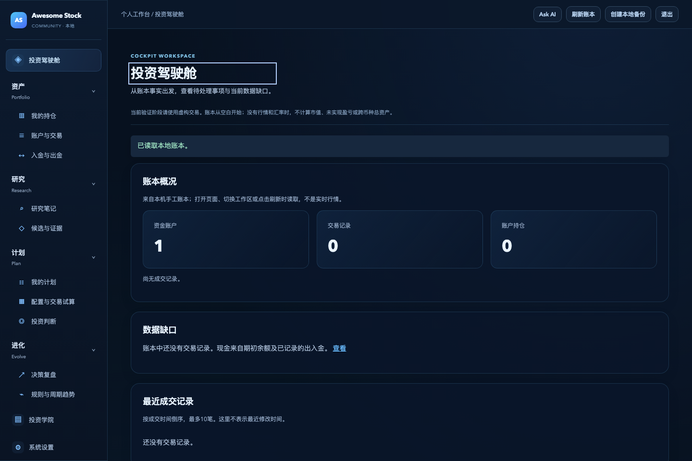
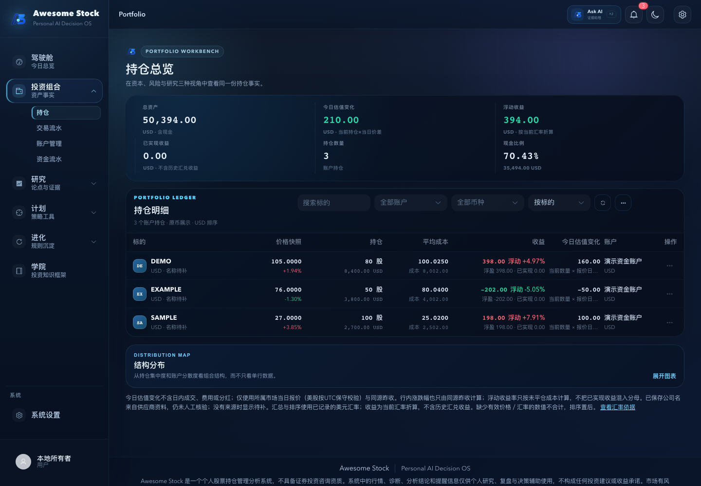
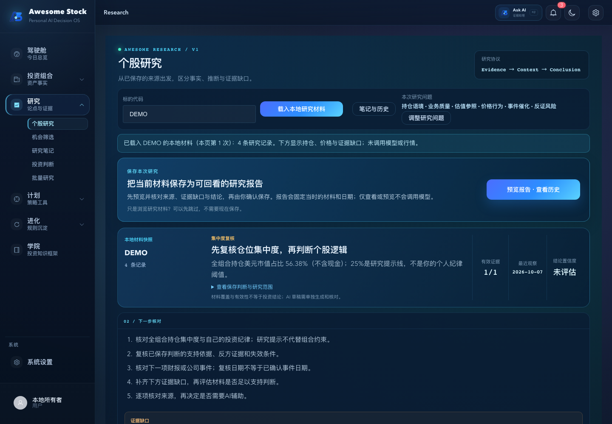
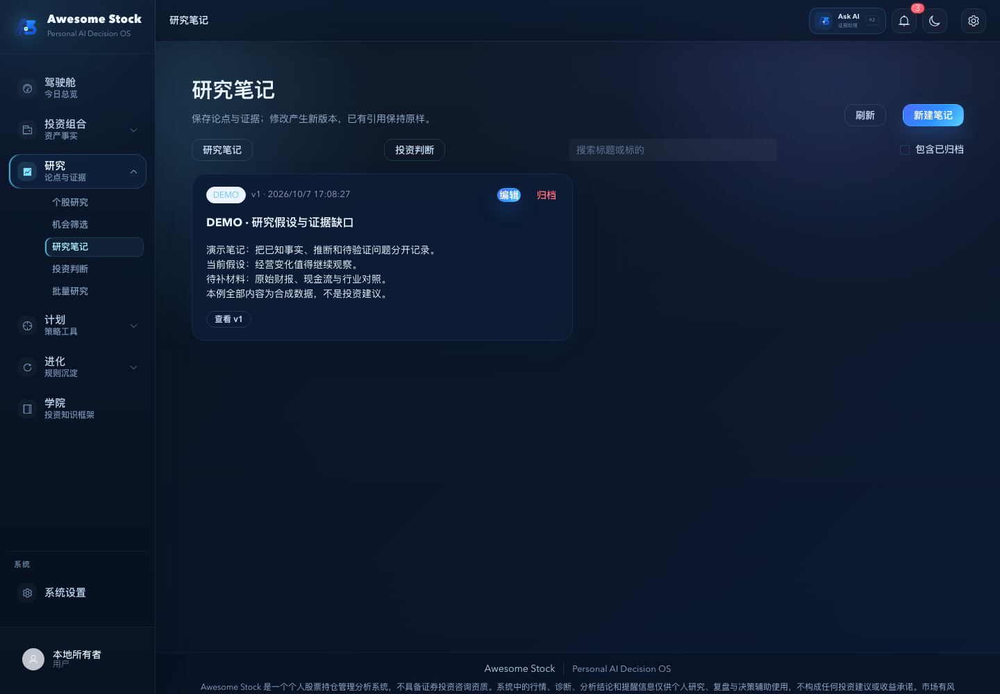
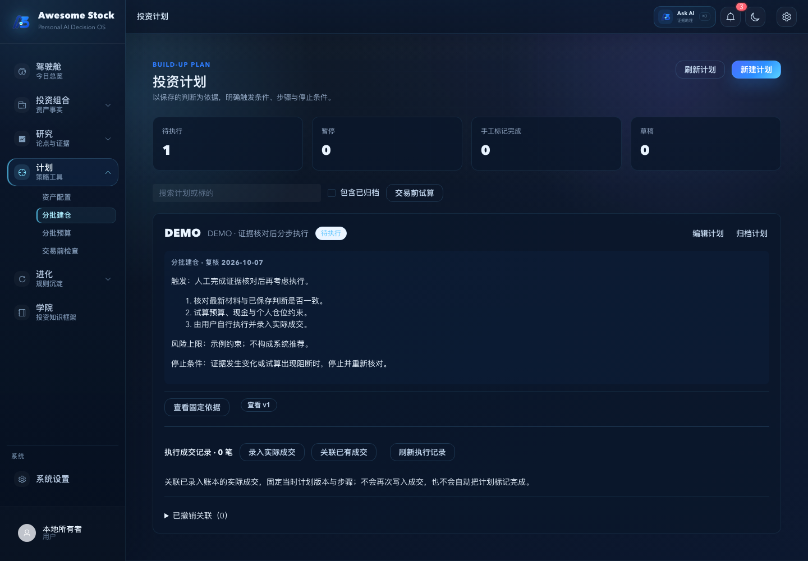
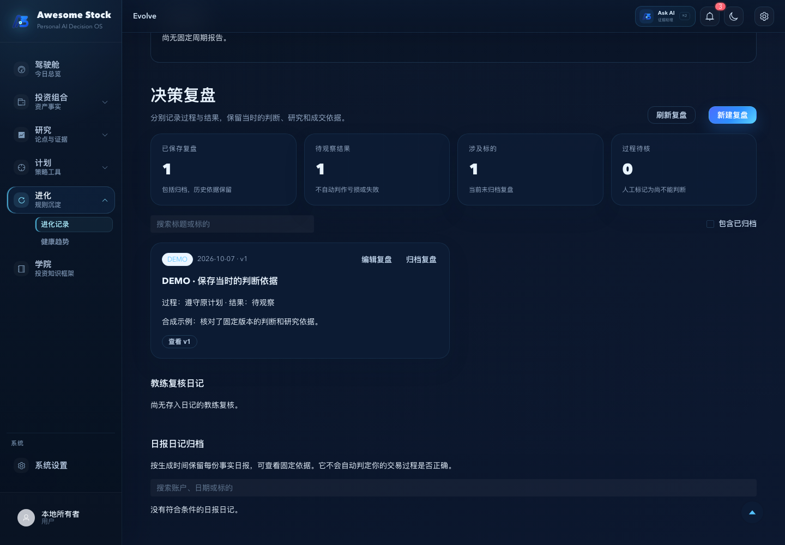
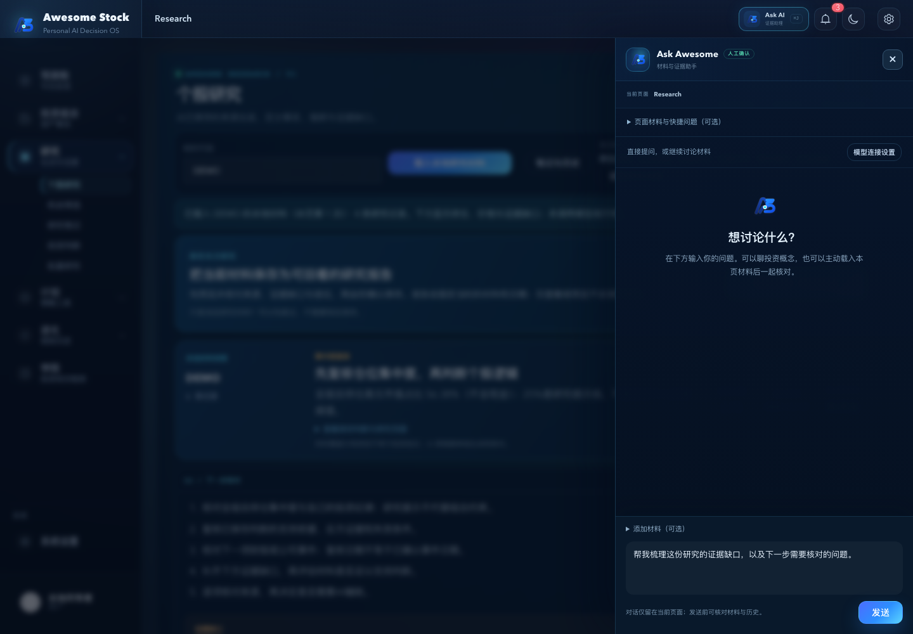
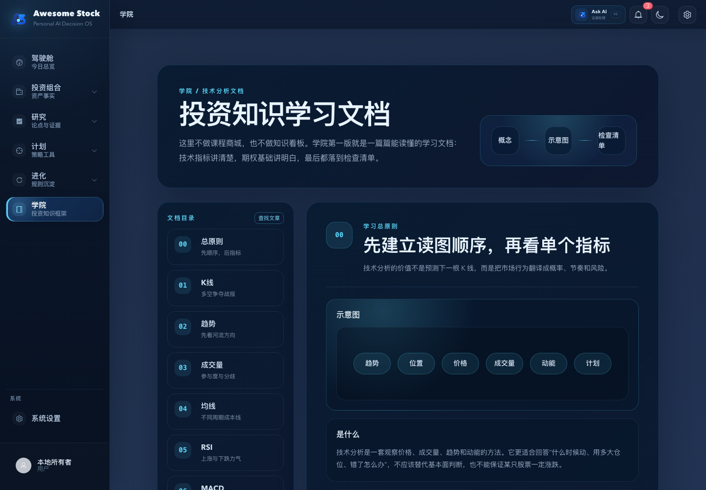
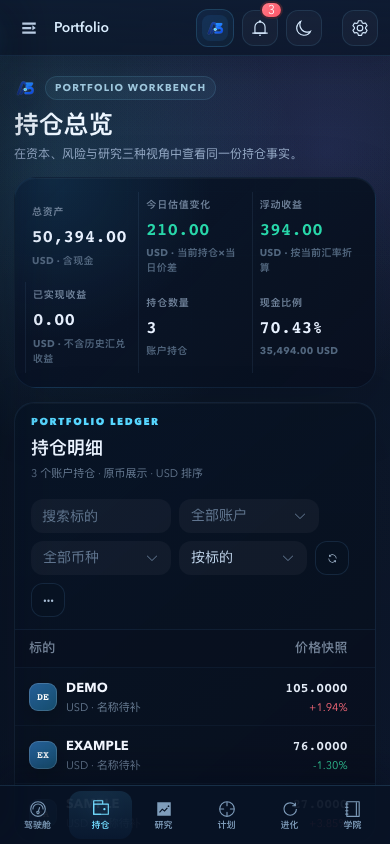
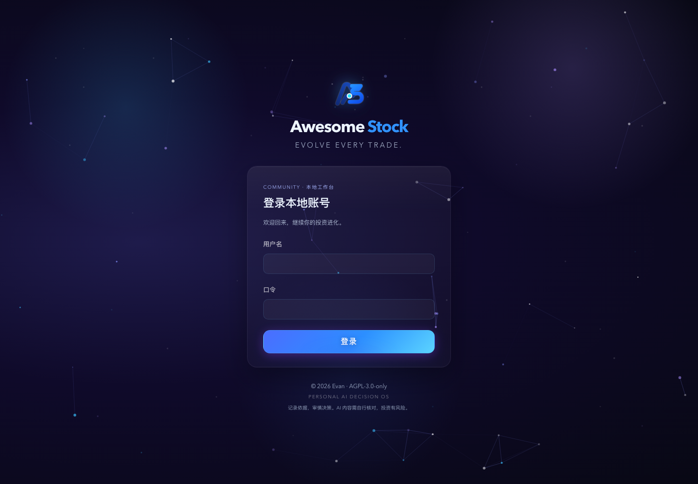

<div align="center">

# 📒 Awesome Stock

**An AI-powered investing journal that doesn't tell you what to buy. Record why you made every trade, review it later, and build your own method.**

100% local data · Bring your own DeepSeek / OpenAI / local Ollama · Works without any API

[](https://github.com/JayeeeJY/awesome-stock/releases)
[](LICENSE)
[](https://www.python.org/)
[](https://github.com/JayeeeJY/awesome-stock/stargazers)

[简体中文](README.md) | English

<!-- Demo GIF is not recorded yet. Replace the screenshot below with docs/screenshots/demo.gif when it exists. -->



</div>

> Holdings in your broker app, research in your notes, and the reason you bought only in your head. When a position goes wrong, you can't remember why you entered.

**Awesome Stock connects the chain:** assets → research evidence → decision → plan → actual trade → decision review

- 🧾 **See where your money is.** Multi-account, multi-currency holdings and trades, with missing prices and FX rates flagged.
- 🔍 **Keep the thesis.** Supporting evidence, counterarguments, invalidation conditions and versioned history.
- 📋 **Check before you act.** Budget, cash and risk-limit checks. You decide whether to execute.
- 🔁 **Review the process, not just the P&L.** Separate "did I follow the plan" from "how did it turn out".
- 🤖 **AI as an assistant, never an autopilot.** Ask Awesome explains material and finds evidence gaps. You approve everything that's sent, and it never places trades.

## 🚀 Run it in 3 steps (macOS Apple Silicon, Python 3.10+)

The native install is checked on macOS Apple Silicon. The release archive includes the compiled interface. Node, a database service and a model are not required.

```sh
# 1. Download and extract the source archive from the latest release
# https://github.com/JayeeeJY/awesome-stock/releases/latest
cd awesome-stock-owner
# 2. Start (no Node, database or model required)
python3 start_owner.py --data-dir "$HOME/Awesome-Stock-Data" --open-browser
# 3. Open http://127.0.0.1:4322/ledger and create your local account
```

`/ledger` opens the trade list. The default port is 4322. If it is taken, add `--port 4324` and open that port instead. There is no default password.

## Docker (Linux, Windows, macOS)

Inside the container the server listens on `0.0.0.0:4322` and stores the ledger in `/data`. The image name is `ghcr.io/jayeeejy/awesome-stock`. GitHub Actions publishes `:v1.1.0`, `:1.1.0` and `:latest` with `GITHUB_TOKEN` when a `v*` tag is pushed. The v1.0.0 and v1.0.1 releases do not include this image. The source archive still has no Dockerfile.

```sh
# Published image (from v1.1.0; :1.1.0 and :latest are the same image)
docker run -p 4322:4322 -v "$HOME/Awesome-Stock-Data:/data" ghcr.io/jayeeejy/awesome-stock:v1.1.0

# Build it yourself. Clone the repository; the release archive has no Dockerfile.
git clone https://github.com/JayeeeJY/awesome-stock.git
cd awesome-stock
docker build -t awesome-stock .
docker run -p 4322:4322 -v "$HOME/Awesome-Stock-Data:/data" awesome-stock
```

Then open http://127.0.0.1:4322/ledger . `-p 4322:4322` listens on every interface of this computer. To keep it on this machine only, use `-p 127.0.0.1:4322:4322`. On startup the container sets `/data` to mode 700. On Windows PowerShell, write the volume as `-v "${env:USERPROFILE}/Awesome-Stock-Data:/data"`.

"Local Ollama" inside the container means the container's own `127.0.0.1`, not Ollama on the host. DeepSeek and OpenAI use the container's outbound network. Keys stay in process memory.

📖 [Quick start](docs/QUICKSTART.md) · ⚙️ [Optional model & market data](docs/OPTIONAL_PROVIDERS.md) · 💬 [Discussions](https://github.com/JayeeeJY/awesome-stock/discussions) · 🗺️ [Roadmap](ROADMAP.md)

> ⭐ If this is useful, star the repo to follow later releases, including a native Windows install.

*Screenshot captured on 2026-10-07 from Community v1.0.1. Accounts, symbols and amounts are synthetic. Not a real portfolio, and not investment advice.*

## A complete workflow in Community

### 1. Start with your assets

The cockpit and portfolio bring together accounts, holdings, valuation and review items. Different accounts and currencies retain their own facts. Manual price snapshots include dates and sources.



### 2. Turn an opinion into research you can check

Start with saved local material. Separate facts from inferences, and record both supporting and opposing evidence. Notes can be revised while references to older versions preserve the original content. A decision includes the evidence that could change your mind.



<details>
<summary>See versioned research notes</summary>



</details>

### 3. Write a plan before taking action

Record the basis, trigger, steps and stop conditions. Check assumptions with allocation, staged-budget and pre-trade scenarios. Execute independently, then link your recorded trade to the plan.



### 4. Review the original decision

Keep an investing journal and revisit the research and decision you held at the time. Record whether you followed the plan, whether an outcome is observable, and what to check next. Community rules are maintained manually by the user.



### 5. Add AI when it helps

Start with a question, or bring current-page material into the conversation. Use Ask Awesome to explain concepts, check the basis of a decision or identify missing evidence.



Responses are for you to read, check and organize. Model connections, outbound content and costs are explained below.

<details>
<summary>See Academy and a mobile-width layout</summary>





*This shows the responsive browser layout. It is not a released mobile app.*

</details>

## AI works with your material; you own the judgment and action

In Community, AI-native collaboration means help understanding and checking material while preserving your control:

- **Ask freely and follow up.** Ask Awesome has a free-text conversation box for investing concepts or discussion of your material.
- **Choose the context.** Explicitly attach current-page material and review the question, material and conversation history before sending. Opening the assistant does not call a model.
- **Choose your service and check the answer.** Use your own DeepSeek or OpenAI API key, or local Ollama. Model responses are assistive drafts, not automatically confirmed decisions, plans or trades.

Models are optional. Ledger, research, planning and review workflows work independently. Data is local by default; only content you confirm for sending is passed to your configured model service.

## Start without an API

Create a local login and capital account, record opening cash and trades, save research, and enter verified manual prices with sources. CSV imports trades after preview, not quote history.

Add optional services when you need them:

- **Models:** your own DeepSeek or OpenAI API account, or user-installed Ollama. API usage charges go to your provider account.
- **Daily market data:** your own Alpha Vantage access for US/A-share data, or EODHD access for Hong Kong. Inspect the query result before explicitly saving it. Yahoo key-free data is deferred; no shared project key or subsidy is provided.
- **Data:** local by default, with a configurable directory and backups. Keys stay in server process memory and are excluded from backups and exports. Full backups are unencrypted and need safe storage.

Download the named source archive from [Releases](https://github.com/JayeeeJY/awesome-stock/releases/tag/v1.1.0), extract it, enter `awesome-stock-owner`, and follow the [installation guide](https://github.com/JayeeeJY/awesome-stock/blob/v1.1.0/OWNER_INSTALL.md). It includes the compiled interface and needs no Node runtime, database service or model to start.

There are no default credentials. The native install is checked on macOS Apple Silicon. Docker can run the same local service on Linux, Windows and macOS; that path is experimental and described above. A native Intel Mac install and a standalone mobile app are not supported. This version has no broker sync, automated trading, short positions or options accounting.

## Make your experience useful

If you want to manage your own investing records, preserve the basis for your decisions and learn from each review, try Community.

[Download](https://github.com/JayeeeJY/awesome-stock/releases/tag/v1.1.0) · [Read the guide](https://github.com/JayeeeJY/awesome-stock/blob/v1.1.0/docs/QUICKSTART.md) · [Share feedback](https://github.com/JayeeeJY/awesome-stock/issues) · [Follow releases](https://github.com/JayeeeJY/awesome-stock/releases)

### Built through everyday use, continually improved

Awesome Stock is a personal investing product from Atom Awareness, created and maintained by Evan. I will keep improving Community through my own everyday use, and welcome questions, ideas and feedback from yours.

Questions belong in [GitHub Discussions](https://github.com/JayeeeJY/awesome-stock/discussions). Bugs and feature ideas belong in [Issues](https://github.com/JayeeeJY/awesome-stock/issues). To change the code, describe the idea in an issue first, then open a pull request. See [CONTRIBUTING.md](CONTRIBUTING.md).

Issues and discussions are welcome. Do not publish API keys, real holdings, transaction details or backups. Security issues should use [GitHub private vulnerability reporting](https://github.com/JayeeeJY/awesome-stock/security/advisories/new).

Copyright (c) 2026 Evan. Project-owned code is [AGPL-3.0-only](https://github.com/JayeeeJY/awesome-stock/blob/v1.1.0/LICENSE); third-party inputs retain their licenses. No separate commercial license is offered for this release. See repository documentation for installation, privacy, security and validation details.

## Sign in



Create your local account on first use; sign in on subsequent visits. The page features a midnight-blue starfield with particle connections and shows static stars when reduced motion is enabled.

[简体中文](README.md)

---

Awesome Stock Community / Powered by Atom Awareness<br>
Independent AI Product & Research Studio · Make complexity perceivable.
