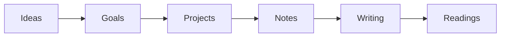

# 02 · jsoncanvas
**by obsidianmd** · [github.com/obsidianmd/jsoncanvas](https://github.com/obsidianmd/jsoncanvas)

> 开放的画布格式 — 你的地图是纯文件，永远属于你。

## Mini map



## 纯文件片段

```json
{
  "nodes": [
    { "id": "a1", "type": "text", "x": 0, "y": 0, "width": 200, "height": 80, "text": "## Ideas" },
    { "id": "a2", "type": "text", "x": 260, "y": 0, "width": 200, "height": 80, "text": "## Goals" }
  ],
  "edges": [
    { "id": "e1", "fromNode": "a1", "toNode": "a2", "fromSide": "right", "toSide": "left" }
  ]
}
```

`.canvas` = JSON。可用任何编辑器打开；本看板本身就是一个 Canvas 文件。
